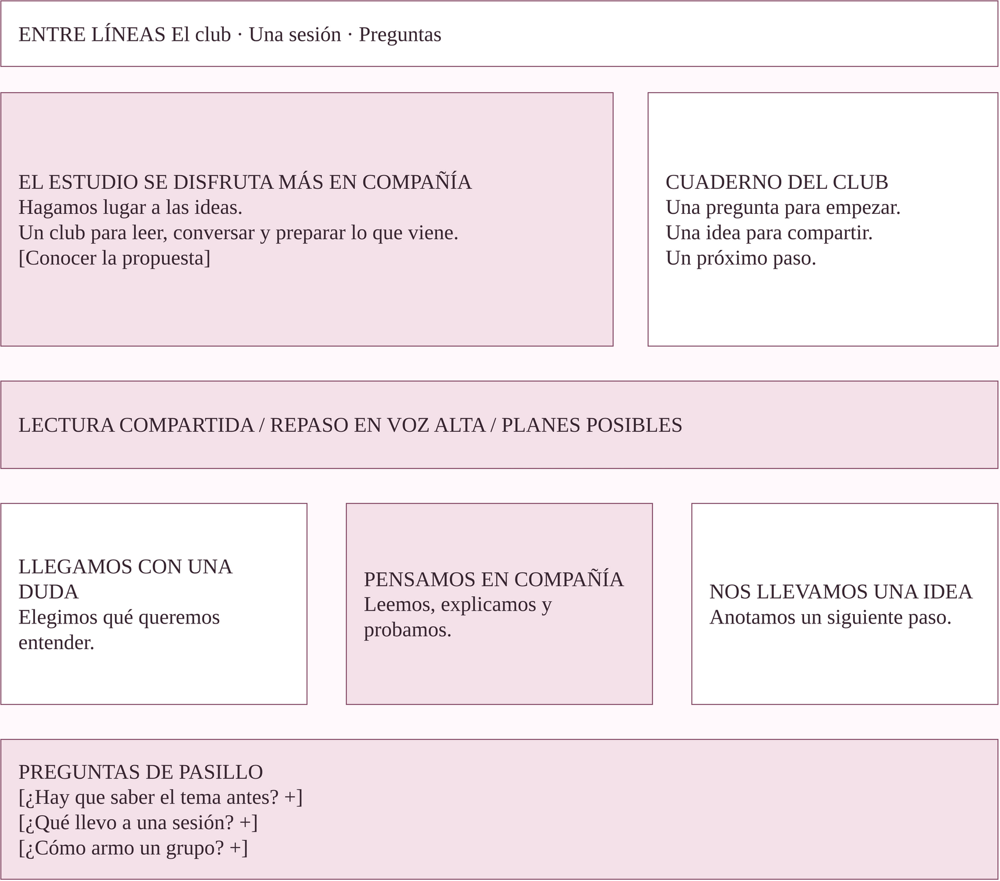
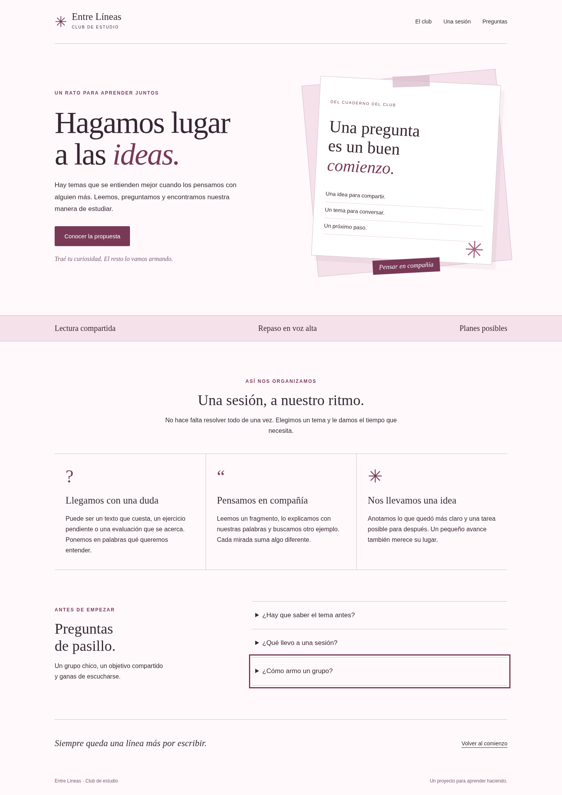
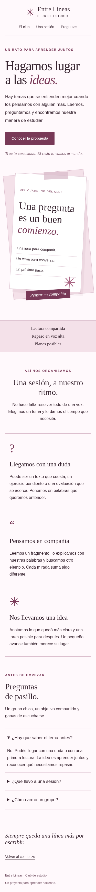

# Landing page — Club Entre Líneas

## 🧩 Datos generales

| Campo | Detalle |
| --- | --- |
| Integrante 1 | Julieta Ini |
| Integrante 2 | No corresponde: trabajo individual |
| Modelos de IA utilizados | ChatGPT; GPT-6 Luna |
| Tecnologías del proyecto | HTML5, CSS3, Markdown y GitHub |
| Link del repositorio | https://github.com/juliini2/landing-page |

---

## Sketch

## Planeamiento

Entre Líneas es un club de estudio para compartir lecturas, explicar temas en voz alta y preparar evaluaciones. La propuesta invita a estudiar en grupos chicos, sin prometer clases ni reservas reales. La identidad combina ciruela, rosa suave, blanco y títulos serif. El boceto define la distribución antes del código; en celular los bloques se apilan.

## Prompt utilizado

> Creá una landing para Club Entre Líneas en index.html y css/style.css, sin JavaScript. Según el boceto, usá encabezado horizontal, una portada de dos columnas (título a izquierda y cuaderno ilustrado con CSS a derecha), una franja con tres propuestas, tres pasos en columnas y preguntas desplegables al final. Título «Hagamos lugar a las ideas». Textos para un club de estudio que comparte lecturas, explica en voz alta y prepara evaluaciones. Paleta ciruela #783957, rosa #f4e1e9, fondo #fff9fc, tinta #382631; títulos Georgia, cuerpo sans serif y líneas finas. El elemento interactivo debe usar details/summary y funcionar con teclado. Navegación interna, salto a contenido, foco visible, móvil desde320px. No inventes horarios, contactos ni inscripciones. Separá el HTML y el CSS y mantené los archivos legibles.

## Resultado

La portada representa un cuaderno de estudio con formas hechas en CSS. Los textos proponen una forma de reunirse, sin anunciar fechas o actividades que no existen. Las tres preguntas se abren con el control nativo del navegador, tanto con mouse como con Enter.

Se comprobaron los enlaces internos, la ausencia de JavaScript y las vistas de 320, 375, 768 y 1280 px. Ninguna presenta desplazamiento horizontal accidental.

## Estado

- [x] Boceto previo al código.
- [x] Prompt registrado.
- [x] Interacción y adaptación comprobadas.
- [x] Código guardado en el repositorio público de GitHub.

## Enlaces

[Repositorio](https://github.com/juliini2/landing-page)

[Visitar el club](https://juliini2.github.io/landing-page/)
